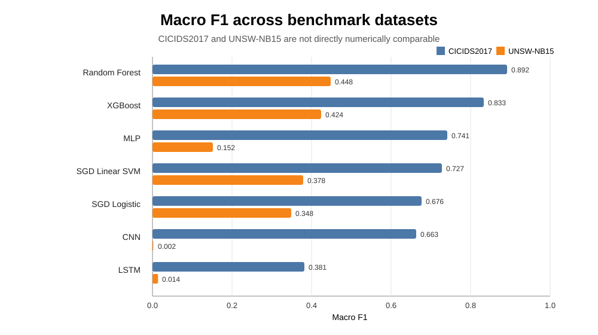

# Network Intrusion Detection: ML vs Deep Learning

**MSc Artificial Intelligence Dissertation — University of Bath (2026)**  
**Dissertation mark: 72%**

Comparative study of machine-learning and deep-learning approaches for **multi-class network intrusion detection** using **CICIDS2017** and **UNSW-NB15**.

The project evaluates seven model families under a documented feature-engineering and class-imbalance pipeline:

- SGD Logistic Regression
- SGD Linear SVM
- Random Forest
- XGBoost
- Multilayer Perceptron (MLP)
- 1D Convolutional Neural Network (CNN)
- Long Short-Term Memory network (LSTM)

\n\n## Headline results

| Model | CICIDS2017 Macro F1 | UNSW-NB15 Macro F1 |
|---|---:|---:|
| **Random Forest** | **0.892** | **0.448** |
| XGBoost | 0.833 | 0.424 |
| MLP | 0.741 | 0.152 |
| SGD Linear SVM | 0.727 | 0.378 |
| SGD Logistic Regression | 0.676 | 0.348 |
| CNN | 0.663 | 0.002 |
| LSTM | 0.381 | 0.014 |

**Random Forest ranked first by Macro F1 on both benchmarks.** On UNSW-NB15, XGBoost produced the highest accuracy and weighted F1, but Random Forest gave the stronger class-balanced result.

> The absolute scores across CICIDS2017 and UNSW-NB15 are **not treated as directly comparable**. The datasets use different sampling, feature structures, attack taxonomies and test designs. The cross-dataset analysis therefore focuses on ranking stability, minority-class behaviour and dataset dependence.

## Research question

How effectively do selected machine-learning and deep-learning models classify intrusion classes across two benchmark IDS datasets, and how do feature engineering, class imbalance and input representation affect the conclusions?

## Methodology

- **Task:** supervised multi-class intrusion detection
- **Random seed:** 42
- **Feature selection:** ANOVA F-score, top 40 encoded features
- **Primary ranking metric:** Macro F1
- **CICIDS2017:** capped stratified sample of 31,193 records, followed by an 80:20 stratified split
- **UNSW-NB15:** official train/test design; training set down-sampled proportionally to 60,000 records and the full 82,332-record official test set retained
- **Imbalance handling:** capped/down-sampled training data plus model-specific class weighting where supported
- **SMOTE:** discussed, but **not used in the final pipeline**

See [METHODOLOGY.md](METHODOLOGY.md) for the methodological caveats and [RESULTS.md](RESULTS.md) for the full result tables.

## Key findings

1. **Random Forest was the strongest class-balanced model** on both datasets under the evaluated settings.
2. **XGBoost did not universally outperform Random Forest.** Its UNSW-NB15 accuracy and weighted F1 were higher, but its Macro F1 was lower.
3. **CNN and LSTM did not provide a practical advantage** with the selected flow-level tabular representations.
4. The neural results are intentionally interpreted cautiously: training budgets differed across datasets and the UNSW-NB15 neural runs contained only one epoch.
5. **Dataset choice materially affects observed IDS performance.** Strong results on one benchmark should not be interpreted as evidence of deployment readiness.
6. Aggregate accuracy and weighted metrics can hide weak rare-attack performance; Macro F1 and class-specific recall are therefore central to the analysis.

## Repository structure

```text
.
├── README.md
├── RESULTS.md
├── METHODOLOGY.md
├── DATASETS.md
├── CITATION.cff
├── requirements.txt
├── config/
│   └── experiment_config.json
└── code/
    ├── run_all.py
    ├── run_cicids2017_analysis.py
    ├── run_unsw_nb15_validation.py
    └── verify_reported_results.py
```

## Running the project

Create a Python environment and install dependencies:

```bash
pip install -r requirements.txt
```

The datasets are deliberately **not committed to this public repository**. Download them from their official sources and place them under the paths described in [DATASETS.md](DATASETS.md).

## Important limitations

This repository preserves the limitations reported in the dissertation rather than presenting the experiments as deployment-ready benchmarks:

- CICIDS2017 used capped sampling, changing the original class prevalence.
- CICIDS2017 median imputation occurred before the 80:20 split in the supplied implementation, creating a limited preprocessing-leakage risk.
- The saved CICIDS2017 XGBoost run used a reduced **6,068-row stratified training subset** because of runtime constraints.
- Neural optimisation was not standardised across datasets.
- The UNSW-NB15 MLP, CNN and LSTM runs used one epoch with batch size 8192.
- Feature selection and class weighting were not isolated through controlled ablation.
- The experiments used benchmark datasets rather than live enterprise traffic.

## Dissertation

**Title:** *Comparative Analysis of Machine Learning and Deep Learning Models for Network Intrusion Detection Using Feature Engineering and Class Imbalance Handling*

See the [dissertation landing page](dissertation/README.md) for the abstract and publication note. The exact assessed PDF is preserved separately from this public-facing repository.

## Dataset attribution

This project uses benchmark datasets created by their respective research teams. The data itself is not republished here.

- CICIDS2017 — Canadian Institute for Cybersecurity, University of New Brunswick
- UNSW-NB15 — UNSW Canberra

Please follow the original dataset licences and citation requirements when downloading or reusing them.

## Author

**Naman Saini**  
MSc Artificial Intelligence, University of Bath  
GitHub: [NamanSaini04](https://github.com/NamanSaini04)

---

This repository is a research/portfolio presentation of an assessed MSc dissertation. Results should be interpreted within the documented experimental design and limitations.
